<p align="center">
  
</p>

<h1 align="center">Kwizo</h1>

<p align="center">
  <b>Quiz yourself. Ace the exam.</b><br />
  Turn your course notes into AI-generated quizzes and spaced-repetition flashcards.
</p>

<p align="center">
  <a href="https://github.com/Anonymat-HS/Kwizo/actions/workflows/ci.yml"></a>
  
  
  
  
  
</p>

<p align="center">
  <a href="https://kwizo.vercel.app"><b>Live app</b></a> ·
  <a href="#screenshots">Screenshots</a> ·
  <a href="#features">Features</a> ·
  <a href="#getting-started">Getting started</a> ·
  <a href="#security">Security</a>
</p>

<p align="center"><sub>A product of <b>H.S</b></sub></p>

<p align="center">
  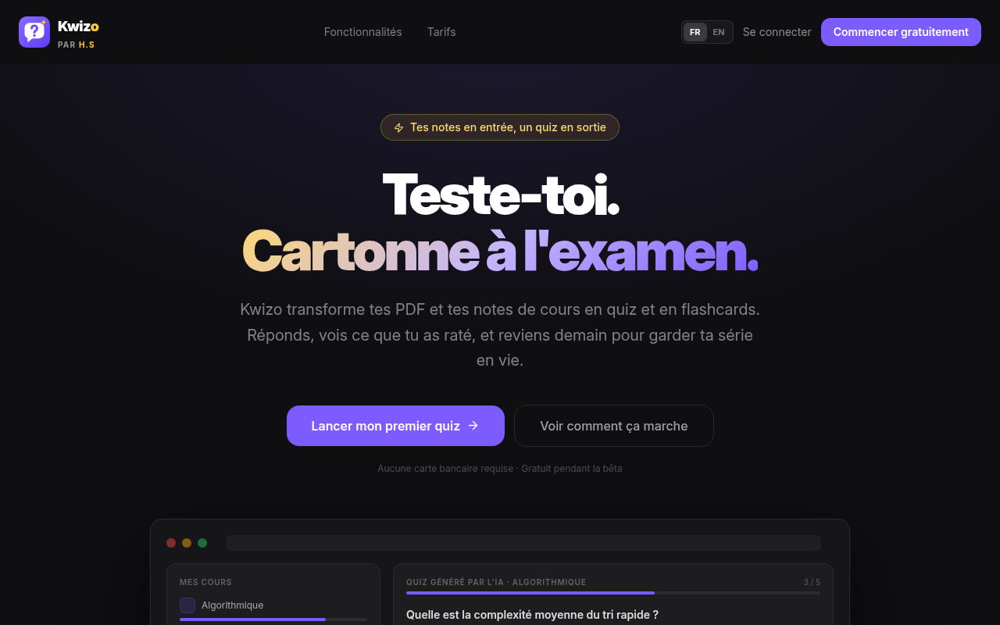
</p>

---

## Why Kwizo

Re-reading and highlighting *feel* productive, but they are weak for long-term memory. What makes knowledge stick is **pulling the answer out of your own head** (active recall), again and again, **spaced over time**.

Kwizo automates the boring part, writing the questions:

1. **Upload** a course: PDF, TXT or Markdown.
2. **Kwizo writes** a varied quiz and a flashcard deck **from your own material**, not from the internet.
3. **Practise**: answer before you see the solution, review what you missed, and let flashcards come back right before you forget them.

It started as a personal need, revising networking, Java and API coursework as a first-year CS student, and is built to grow into a tool for any student or institution.

<a id="screenshots"></a>

## Screenshots

> The UI is in French by default (an FR / EN switch is always one click away). Screenshots use demo data.

<table>
  <tr>
    <td width="50%">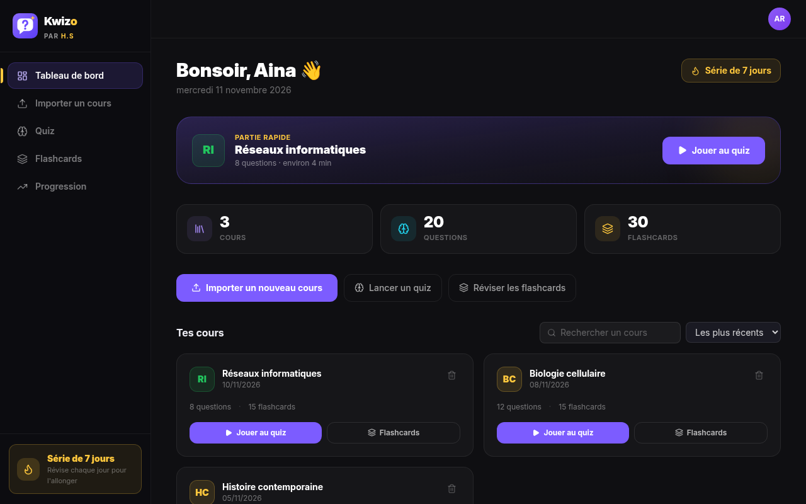<br /><b>Dashboard</b>: streak, quick play, every course one click away</td>
    <td width="50%">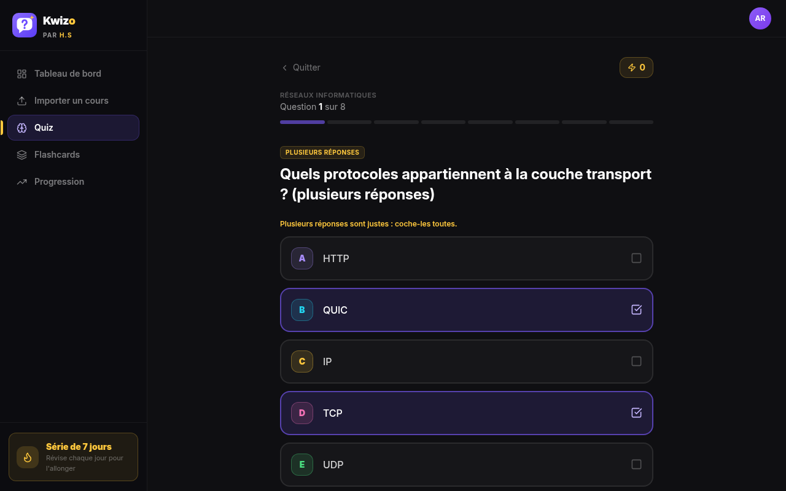<br /><b>Several right answers</b>: tick them all, then validate</td>
  </tr>
  <tr>
    <td>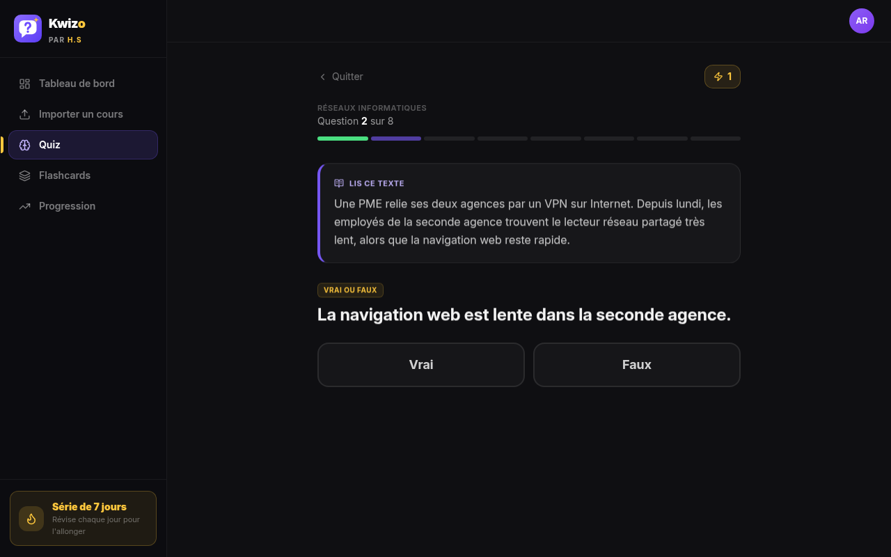<br /><b>Reading passage</b>: a short text or case study, then questions on it</td>
    <td>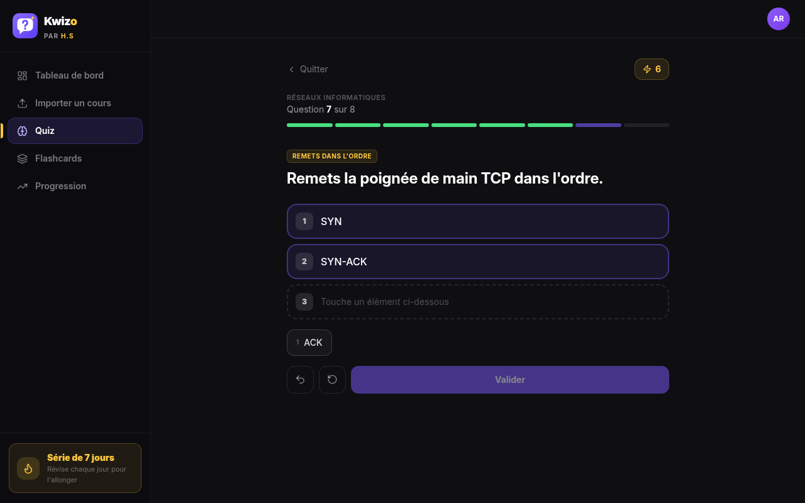<br /><b>Put in order</b>: tap the items in sequence (phone-friendly)</td>
  </tr>
  <tr>
    <td>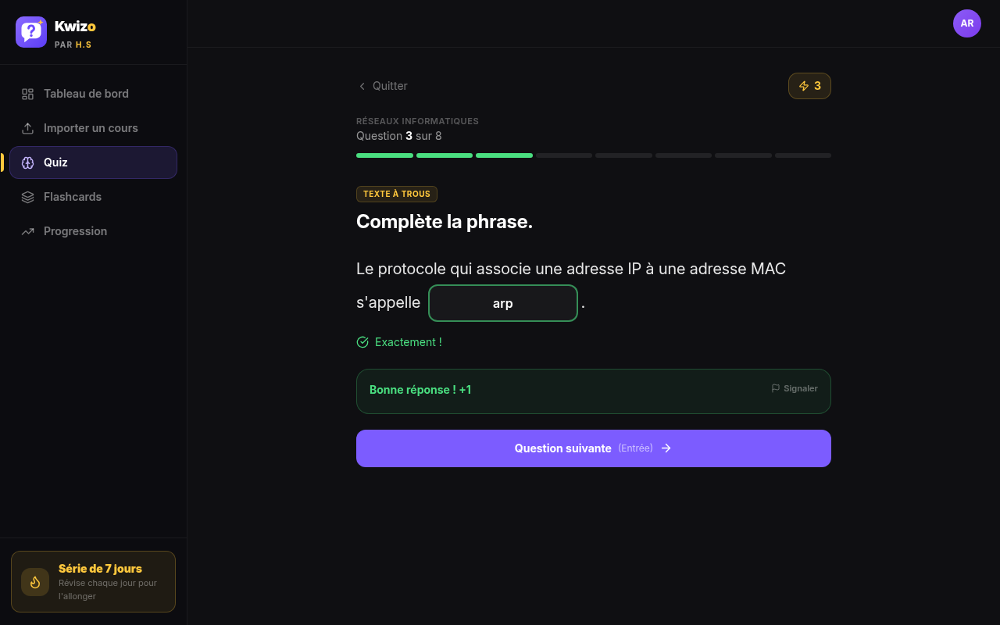<br /><b>Fill in the blank</b>: typed answers forgive case, accents and small typos</td>
    <td>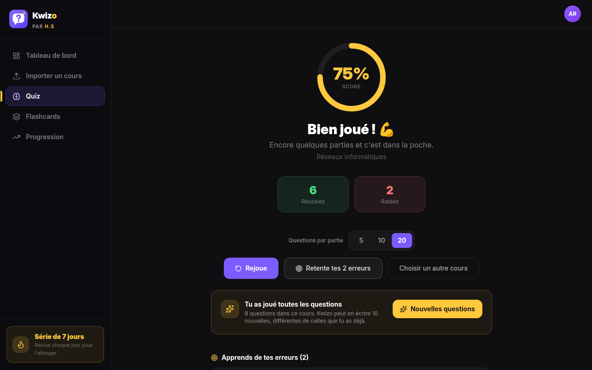<br /><b>Results</b>: score, replay, retry your misses or ask for new questions</td>
  </tr>
  <tr>
    <td>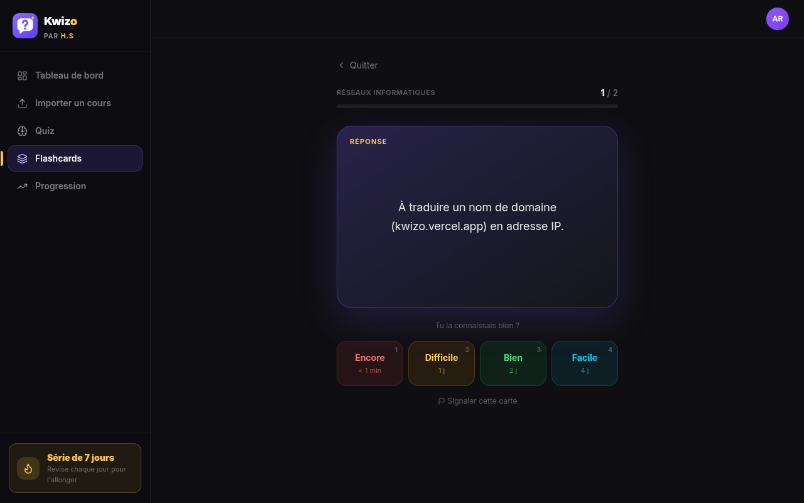<br /><b>Flashcards</b>: 3D flip and spaced-repetition rating</td>
    <td>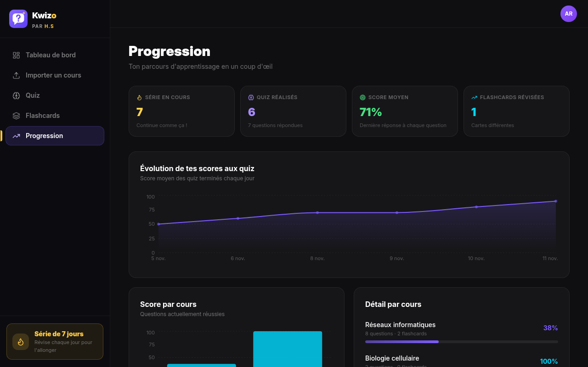<br /><b>Progress</b>: streak, scores over time, per-course breakdown</td>
  </tr>
  <tr>
    <td>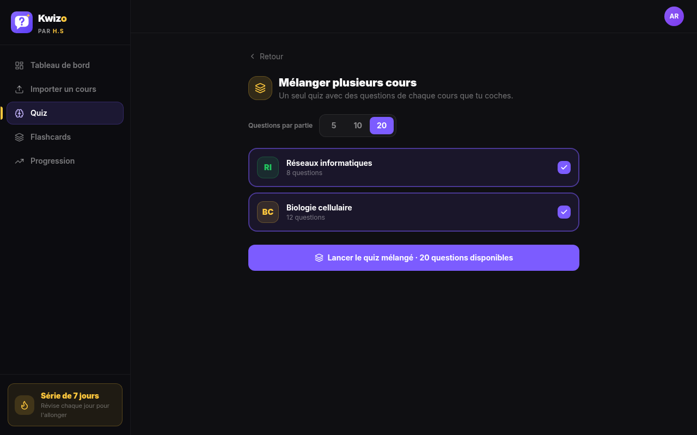<br /><b>Mixed quiz</b>: one session across several courses</td>
    <td>
      <p align="center">
        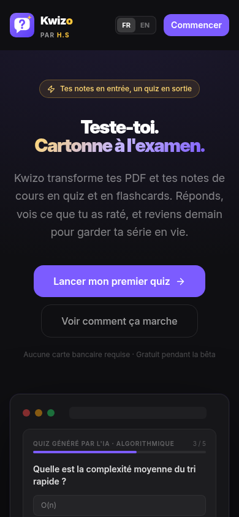
        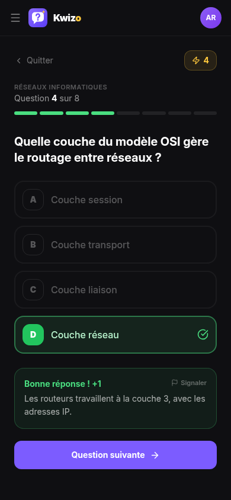
      </p>
      <b>Mobile</b>: every screen works at phone width
    </td>
  </tr>
</table>

<a id="features"></a>

## Features

### Six question types, mixed by the AI

| Type | How you answer | Grading |
|---|---|---|
| Single answer | tap one of 4 options (or press `1`-`4` / `A`-`D`) | — |
| **Several right answers** | tick 2-3 of 4-5 options, then validate | all-or-nothing |
| True / False | two big buttons | — |
| Short answer | type it | lenient: case, accents, punctuation, a leading article ignored, 1-2 typos forgiven on words; numbers exact |
| Fill in the blank | type the missing word in the sentence | same as short answer |
| Put in order | tap the items in sequence | exact order |

Plus **reading passages**: a short text or case study followed by 2-3 questions, always played together.

### Study
- **Fresh sessions**: each quiz picks 5, 10 or 20 questions, never-played first, then missed ones, in a new order
- **Mistake review** at the end of a quiz, and **"Retry my misses"** to replay only those
- **New questions on demand**: another set of questions or cards, different from the ones you have
- **Mixed quiz**: tick several courses and play one quiz across all of them
- **Flashcards** rated *Again / Hard / Good / Easy*: the rating schedules the next review
- **Keyboard first**: answer, validate and move on without the mouse

### Track
- **Streak**, average score, scores over time and per-course breakdown
- **Dashboard** with quick play, search, sort, rename and delete

### Care
- **Report** a wrong or unclear question or card in one click
- **Give feedback** from the account menu (rating + message), read by the team in Supabase

### Platform
- **French and English**, French by default
- **Plans and quotas** stored in the database (see [Plans and limits](#plans-and-limits))
- **Swappable LLM provider**: Groq (default), Gemini or Ollama
- Responsive dark UI, accessible labels, visible keyboard focus, respects `prefers-reduced-motion`

## Tech stack

| Layer | Technology |
|-------|-----------|
| Frontend | React 19, Vite 8, TypeScript, Tailwind CSS v4 |
| Icons / charts | Lucide React, Recharts |
| Routing | Hash-based (`#/quiz/<courseId>`), handled in `src/App.tsx`, no router dependency |
| Backend | Supabase Edge Functions (Deno) |
| Database & auth | Supabase (PostgreSQL + Row Level Security) |
| AI / LLM | Provider abstraction: Groq (`openai/gpt-oss-120b` by default), Gemini, Ollama |
| PDF parsing | `unpdf` (Deno-compatible) |
| Quality | Vitest, ESLint, GitHub Actions CI |
| Hosting | Vercel (frontend), Supabase (backend) |

## How it works

1. **Upload**: the Upload page sends the file to the `extract-course` Edge Function, which extracts the text and stores the course.
2. **Generate**: `generate-quiz` and `generate-flashcards` send a sample of the course text to the LLM, validate its JSON output and save the questions and cards.
3. **Practise**: the Quiz and Flashcards pages read them back; every answer and rating is saved to the user's progress.
4. **Track**: the Progress page and the `useUserStats` hook turn that history into streaks, scores and activity charts.

Screens never query tables directly: all data access goes through the typed layer in `src/lib/api/`.

## Project structure

```
src/
  App.tsx                # Hash routing, auth flow, layout
  main.tsx               # React entry point
  index.css              # Global styles and Tailwind import
  pages/                 # One file per screen (Landing, auth, Dashboard, Upload, Quiz, Flashcards, Progress, Profile)
  components/
    layout/              # Sidebar, AvatarMenu
    ui/                  # Logo, AuthCard, ErrorState, SaveWarning, DeleteAccount
  hooks/                 # useUserStats
  lib/
    api/                 # Typed data-access layer (the only place that queries Supabase tables)
    supabase/            # Client, auth context (useAuth), Edge Function calls
    types.ts             # Shared TypeScript types
    utils/               # Pure helpers: quotes, streak stats, spaced repetition, quiz grading

supabase/
  schema.sql             # Full schema + RLS + indexes (fresh install)
  storage.sql            # Avatars bucket + policies
  migrations/            # SQL to upgrade a database created with an older schema
  functions/
    extract-course/      # PDF / TXT / MD → text
    generate-quiz/       # LLM → quiz questions → DB
    generate-flashcards/ # LLM → flashcards → DB
    delete-account/      # Deletes the caller's account and data
    _shared/             # CORS/auth/error helpers, generation lock, plans, LLM layer
```

## Getting started

Requirements: Node.js 20+, npm, and the [Supabase CLI](https://supabase.com/docs/guides/cli).

```bash
git clone https://github.com/Anonymat-HS/Kwizo.git
cd Kwizo
npm ci
cp .env.example .env   # then fill in VITE_SUPABASE_URL and VITE_SUPABASE_PUBLISHABLE_KEY
npm run dev            # http://localhost:8443
```

### Supabase setup

1. Create a project at [supabase.com](https://supabase.com).
2. In the SQL Editor, run `supabase/schema.sql`, then `supabase/storage.sql`.
   For an existing database, run the files in `supabase/migrations/` in order instead.
3. Deploy the Edge Functions with the CLI (they import `_shared/`, which the dashboard editor cannot bundle):
   ```bash
   supabase functions deploy extract-course generate-quiz generate-flashcards delete-account --project-ref <ref>
   ```
4. Set the secrets:
   ```bash
   supabase secrets set LLM_PROVIDER=groq GROQ_API_KEY=<your-key> ALLOWED_ORIGINS=http://localhost:8443 --project-ref <ref>
   ```

## Translations

The UI is in French (default) and English, with no i18n dependency (`src/lib/i18n/`).
Write the English text in the code and wrap it: `const { t } = useT()`, then `t("Play again")` or
`t("{n} questions", { n })`. Add the French version to the matching file in `src/lib/i18n/fr/`.
`npm test` fails if a `t("...")` text has no French entry or if a translation drops a `{placeholder}`.

## Scripts

| Command | What it does |
|---|---|
| `npm run dev` | Start the Vite dev server on port 8443 |
| `npm run build` | Production build into `dist/` |
| `npm run preview` | Serve the production build locally |
| `npm run typecheck` | `tsc --noEmit` |
| `npm run lint` | ESLint |
| `npm test` | Vitest (unit tests on the pure logic: spaced repetition, stats, quiz grading, LLM parsing) |
| `npm run test:db` | Database security tests in a throwaway local Postgres (needs `initdb` / `pg_ctl` / `psql`) |

CI runs typecheck, lint, tests and build on every pull request.

## Environment variables

**Frontend** (`.env`, and the Vercel project settings)

| Variable | Description |
|----------|-------------|
| `VITE_SUPABASE_URL` | Supabase project URL |
| `VITE_SUPABASE_PUBLISHABLE_KEY` | Supabase anon / publishable key |

**Edge Functions** (`supabase secrets set ...`)

| Variable | Description |
|----------|-------------|
| `LLM_PROVIDER` | `groq` (default), `gemini` or `ollama` |
| `GROQ_API_KEY` | Groq API key (when using Groq) |
| `GROQ_MODEL` | Optional. Groq model id (default `openai/gpt-oss-120b`) |
| `GEMINI_API_KEY` | Gemini API key (when using Gemini) |
| `OLLAMA_URL` | Ollama endpoint (when using Ollama) |
| `LLM_MAX_INPUT_WORDS` | Optional. Words of course text sent to the LLM (default 2200) |
| `ALLOWED_ORIGINS` | Comma-separated app origins allowed to call the functions (e.g. `https://kwizo.vercel.app,http://localhost:8443`). Unset = any origin, for development only |

## Reading reports and feedback

Reports and feedback land in the `feedback` table (migration `005_feedback.sql`). Users can only write
their own rows; read them in the Supabase dashboard (**Table editor → feedback**), newest first. A
report keeps a `snapshot` of the question so it stays readable if the course is deleted. Each user can
send at most 30 messages a day.

## Security

- **Row Level Security** on every table: a user only reads their own data. Courses, questions, cards,
  plans and quotas are written by the Edge Functions only (service role).
- **Quotas** (daily uploads, LLM calls per hour) are counted in `usage_events` by `claim_usage()`, atomically
  and independently of the content, so deleting a course never gives quota back (migration `006_security.sql`).
- **Feedback**: the sender, the date and the target's ownership are set or checked by a trigger.
- **Avatars**: one file per user; nobody can list other users' folders.
- **Headers** (`vercel.json`): strict CSP pinned to the project's Supabase URL, HSTS, `X-Frame-Options`,
  `Permissions-Policy`, `Cross-Origin-Opener-Policy`.
- **Tests**: `npm run test:db` loads `schema.sql` into a throwaway local Postgres and replays attacks
  (`supabase/tests/security.test.sql`). It runs in CI on every pull request.

## Deployment

The frontend is deployed on Vercel from `main`; `vercel.json` adds the security headers (CSP, `X-Frame-Options`, ...). When the app is served from a new domain:

1. Add the domain to the `ALLOWED_ORIGINS` secret, otherwise the Edge Functions reject the calls (CORS).
2. In Supabase, go to **Authentication → URL Configuration** and set the **Site URL** and **Redirect URLs** to the domain, otherwise password-reset links point to the old one.

## Plans and limits

Upload size, daily course quota and generation sizes are per plan. They live in the `plans` table (`supabase/migrations/003_plans.sql`), so they change with an `UPDATE` and need no redeploy.

| Plan | Max file | Courses / 24 h | Questions / quiz | Cards / deck | Sets per course |
|---|---|---|---|---|---|
| `free` | 20 MB | 10 | 20 | 30 | 3 |
| `premium` | 50 MB | 50 | 30 | 60 | 10 |
| `business` | 100 MB | 200 | 40 | 80 | 25 |
| `bold` | 200 MB | 500 | 50 | 100 | 50 |

A *set* is one generation round: the upload creates set 1, and each **New questions** /
**More cards** click adds one (`plans.max_rounds`, migration `004_rounds.sql`). A new set
gets the existing questions to avoid and a different excerpt of long courses.

A user with no row in `user_plans` is on `free`. Assigning a plan is a service-role write (billing or an admin), never a client one:

```sql
insert into user_plans (user_id, plan)
select id, 'premium' from auth.users where email = 'user@example.com'
on conflict (user_id) do update set plan = excluded.plan, updated_at = now();
```

The seeded numbers are placeholders; adjust them with `update plans`. Limits are enforced server-side: the Upload page displays them, but the Edge Functions are the authority.

## Known limitations

- Text-based PDFs only (no OCR for scanned documents)
- 2200 words of course text are sent to the LLM per generation
- No payment integration yet: plans are assigned manually

## More context

- [`ROADMAP.md`](./ROADMAP.md): development progress tracker
- [`PROJECT.md`](./PROJECT.md): original architecture notes (partly outdated: it predates the move to Vite and Supabase Edge Functions)
- [`AGENTS.md`](./AGENTS.md): conventions for contributors and AI assistants

## License

Proprietary. Copyright (c) 2026 Herimihaja Steevy RASOAMIARAMANANA. All rights reserved.
No use, copy, modification or distribution without written permission. See [`LICENSE`](./LICENSE).
